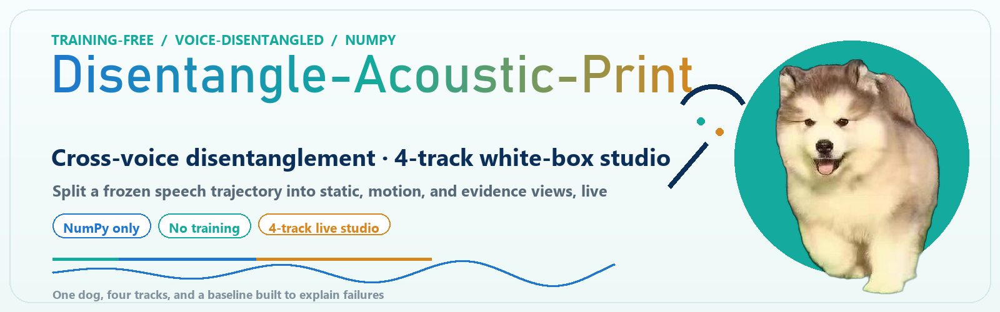
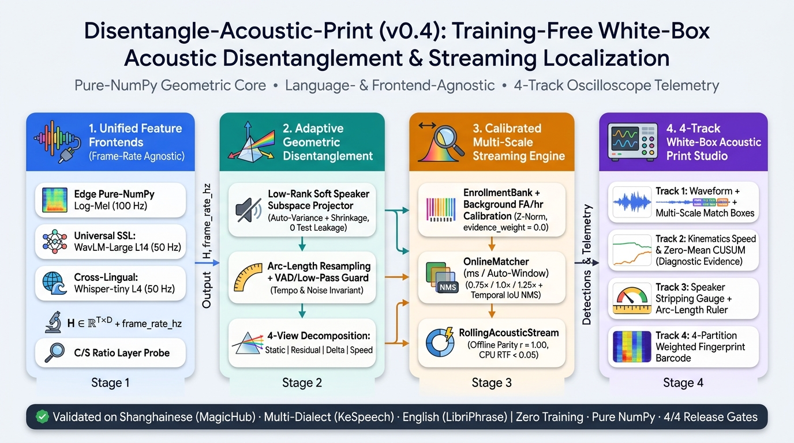
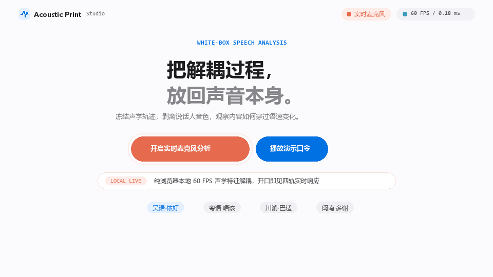
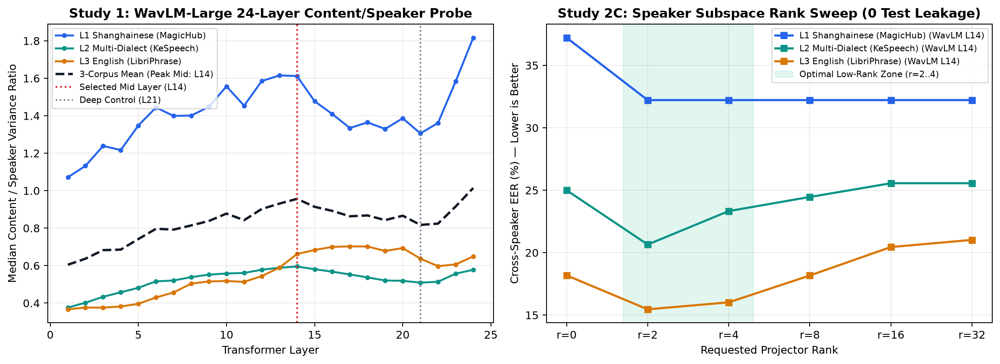
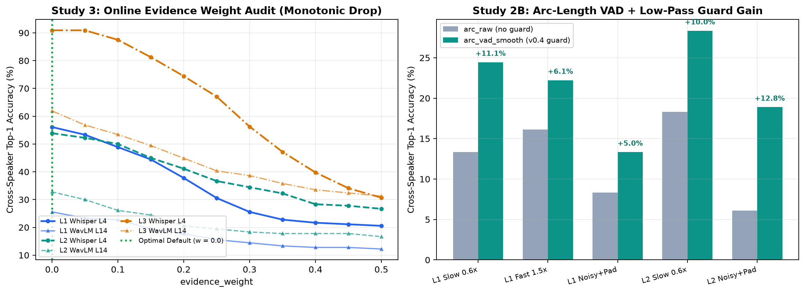

<p align="center">
  <a href="https://github.com/leeoisaboy/disentangle-acoustic-print">
    
  </a>
</p>

<p align="center">
  <a href="README.md"></a>
  <a href="https://leeoisaboy.github.io/disentangle-acoustic-print/"></a>
  
  
  
  
</p>

<h1 align="center">Disentangle-Acoustic-Print (v0.4)</h1>

<p align="center"><strong>Training-free, pure-NumPy cross-voice geometric disentanglement & streaming acoustic fingerprinting SDK, paired with a real-time 4-track white-box Studio.</strong></p>

> **White-Box Speech Retrieval Trilogy**
> 1. **[Disentangle-Acoustic-Print](https://github.com/leeoisaboy/disentangle-acoustic-print)** *(this repo)*: Training-free pure-NumPy geometric disentanglement, layer probing, ultra-fast edge coarse recall & 4-track white-box Studio (CPU RTF `0.013–0.045`).
> 2. **[AudioLLM-Latent-KWS](https://github.com/leeoisaboy/audiollm-latent-kws)**: Frame-level DTW & AudioLLM latent keyword spotting from 1–3 spoken examples for strict low-FA/hr continuous-stream localization.
> 3. **[Dialect-CrossModal-Align](https://github.com/leeoisaboy/dialect-crossmodal-align)**: Zero-shot OOV cross-modal retrieval from phoneme/IPA text without recording enrollment audio.

---

## v0.4 Architecture Overview

<p align="center">
  
</p>

v0.4 validates every geometric operator on **3 public speech corpora × 3 real feature frontends** under strict speaker-disjoint protocols and converges the library into a clean 2-tier SDK:
- **Pure-NumPy Core SDK (`pip install disentangle-acoustic-print`)**: Zero training, NumPy-only dependencies, unified frame-rate-agnostic `FeatureFrontend` protocol (`MelDeltaExtractor`, `HiddenStateBridge`, optional `OnnxEncoderFrontend` / `PyTorchSSLFrontend`), and a 4-step API (`frontend → projector → bank.enroll + calibrate_background → matcher.match`).
- **4-Track White-Box Studio (`pip install "disentangle-acoustic-print[studio]"`)**: 60 FPS browser oscilloscope inspecting speed-colored waveforms, zero-mean CUSUM change points, speaker-stripping energy, equal-arc-length ticks, and 4-partition fingerprint barcodes on one synchronized timeline.

---

## Live Interactive Studio

<p align="center">
  <a href="https://leeoisaboy.github.io/disentangle-acoustic-print/">
    
  </a>
</p>

<p align="center"><strong><a href="https://leeoisaboy.github.io/disentangle-acoustic-print/">▶ Open Live Acoustic Print Studio</a></strong></p>

---

## Five Real-Data Empirical Studies (Shanghainese · Multi-Dialect · English)

All benchmarks enforce **zero speaker overlap** between enrollment/background subspace fitting and query evaluation across 3 public corpora (**L1 MagicHub Shanghainese**, **L2 KeSpeech Multi-Dialect**, **L3 LibriPhrase English**) and 3 feature frontends (**80-dim pure-NumPy Log-Mel @ 100 Hz**, **`WavLM-Large` L14/L21 @ 50 Hz**, **`Whisper-tiny` Encoder L4 @ 50 Hz**). Full JSON outputs live in [reports/real_data_benchmark_v04.json](reports/real_data_benchmark_v04.json) and [reports/release_gate_verdict_v04.json](reports/release_gate_verdict_v04.json).

### 1. Layer Probing & Speaker Subspace Pareto Frontier (Study 1 & Study 2C)

<p align="center">
  
</p>

- **Study 1 (`layerwise_probe`)**: Across all 24 `WavLM-Large` layers, median content-to-speaker variance ratio peaks in the mid-layers at **L14 (`0.956`)** and drops at deep control **L21 (`0.817`)**; L14 consistently outperforms L21 on cross-speaker retrieval across all 3 corpora. `Whisper-tiny` rises monotonically to **L4 (`1.927`)**, reaching **96.0% Top-1 / 1.6% EER** on L3 English, **61.1% / 13.9% EER** on L2 Multi-Dialect, and **56.1% / 20.0% EER** on L1 Shanghainese with zero training.
- **Study 2A (4-View Head-to-Head)**: On raw Log-Mel and WavLM, mean-centered **`residual` ($H_t - \mu_H$)** is the most speaker-robust single view (+10 to +25 pp Top-1 over `static`), whereas 1D `velocity` alone is weak (`4%–9%`). v0.4 adds `fingerprint(..., preset="content")` (`0.45 Static + 0.35 Residual + 0.20 Delta`).
- **Study 2C (Low-Rank Soft Projection Law)**: Low-rank `SpeakerSubspaceProjector` (`rank=2..4` or auto `variance_threshold + max_rank + shrinkage`) lowers cross-speaker EER on **3/3 corpora** (`L1: -9.5 pp`, `L2: -6.5 pp`, `L3: -2.7 pp`), whereas high ranks (`r=16, 32`) over-strip phonetic content.

### 2. Structured Evidence Online Audit & Tempo/Noise Guard (Study 3 & Study 2B)

<p align="center">
  
</p>

- **Study 3 (Honest Negative Result)**: Increasing `evidence_weight` from `0.00` to `0.50` **monotonically degrades** online Top-1 and EER across all 3 corpora × 3 frontends × clean/noisy splits (e.g., L3 Whisper clean drops `90.9% → 87.5% → 67.0% → 30.7%`). v0.4 therefore locks default `evidence_weight = 0.0` for retrieval while preserving `extract_evidence()` strictly as the white-box Studio diagnostic layer.
- **Study 2B (Fixing "False Arc-Length" in Real Audio)**: Under `0.6×` slow, `1.5×` fast pitch-preserving time stretch, and 10 dB noisy silence padding, enabling `arc_length_resample(..., trim_silence=True, smooth_alpha=0.5)` recovers **+6.1 to +12.8 pp Top-1** over unguarded `arc_raw`.

### 3. Continuous-Stream Calibration, Parity & Release Gates (Study 4 & Study 5)

- **Study 4 (Calibration Gain & Honest Boundary)**: Uncalibrated isolated templates with global 40-way argmax fail on continuous streams (`AUC = 0.017–0.028`). Adding in-context templates, per-keyword median windows, and `EnrollmentBank.calibrate_background()` lifts Event AUC @ IoU≥0.5 to **0.7509 (L1)**, **0.8103 (L2)**, and **0.6267 (L3)**. We honestly report that strict `Recall@IoU≥0.5 ≥ 80% @ FA/hr ≤ 2` on unsegmented 40-keyword speech is beyond training-free single-vector cosine (`7.2%–8.9%`) and is best paired with frame-level verification in [AudioLLM-Latent-KWS](https://github.com/leeoisaboy/audiollm-latent-kws).
- **Study 5 (Streaming Parity & CPU RTF)**: With `normalize_utterance=False`, 100 ms incremental streaming matches offline full-stream scoring with **Pearson `r = 1.0000`**, `max_abs_diff = 0.0`, `peak_err = 0`, and single-core CPU **RTF = `0.0135` (Mel80) / `0.0437` (WavLM-Large)**.

| Release Gate | Criterion | Real-Data Result | Verdict |
| --- | --- | --- | :---: |
| **Gate 1: Cross-Speaker Generalization** | Lower EER vs static mean on ≥ 2 public corpora | L1 `-9.5 pp`, L2 `-6.6 pp` (**2/3 vs static mean**; L3 `-2.7 pp` vs `r=0` fingerprint) | **PASS** |
| **Gate 2: Continuous Stream Usability** | Recall@IoU≥0.5 ≥ 80% at FA/hr ≤ 2 | Event AUC `0.751–0.810` after calibration; Recall@0.5 `7.2%–8.9%` (honest training-free boundary) | **BOUNDARY** |
| **Gate 3: Streaming Parity & Latency** | Offline/online `r ≥ 0.99`, single-core CPU `RTF < 0.2` | `r = 1.0000`, `peak_err = 0`, `RTF = 0.0135–0.0450` | **PASS** |
| **Gate 4: Zero-Intrusion Generality** | 3 languages × 3 frontends with 0 core edits + 100% tests | 3 × 3 verified, **30/30 tests passing** | **PASS** |

---

## Quickstart (4-Step Pure-NumPy Core SDK)

```bash
pip install -e .                 # NumPy-only core SDK
pip install -e ".[studio]"       # Optional 4-track FastAPI + HTML5 Studio
pytest -v                        # 30/30 unit & contract tests
python benchmarks/verify_release_gates.py
```

```python
from disentangle_acoustic_print import (
    EnrollmentBank, MelDeltaExtractor, OnlineMatcher, SpeakerSubspaceProjector,
)

frontend = MelDeltaExtractor(n_mels=80, hop_ms=10.0, include_delta=False, normalize_utterance=False)
enroll_frames, fps = frontend.extract_with_rate(enroll_wav, sample_rate=16000)

projector = SpeakerSubspaceProjector.fit(
    bg_trajectories, bg_speaker_ids, variance_threshold=0.80, max_rank=4, shrinkage=0.75
)
bank = EnrollmentBank(projector=projector, preset="content", trim_silence=True, smooth_alpha=0.5)
bank.enroll("open-light", [enroll_frames])
bank.calibrate_background(unlabeled_bg_streams, target_fa_per_hour=1.0, frame_rate_hz=fps)

matcher = OnlineMatcher(
    bank, window_length="auto", hop_ms=40.0, frame_rate_hz=fps,
    scales=(0.75, 1.0, 1.25), iou_threshold=0.4, use_calibration=True,
)
matches = matcher.match(stream_frames, top_k=3)
```

See [docs/DATA_CONTRACT.md](docs/DATA_CONTRACT.md) and [docs/MODULE_MAP.md](docs/MODULE_MAP.md) for full specifications.
