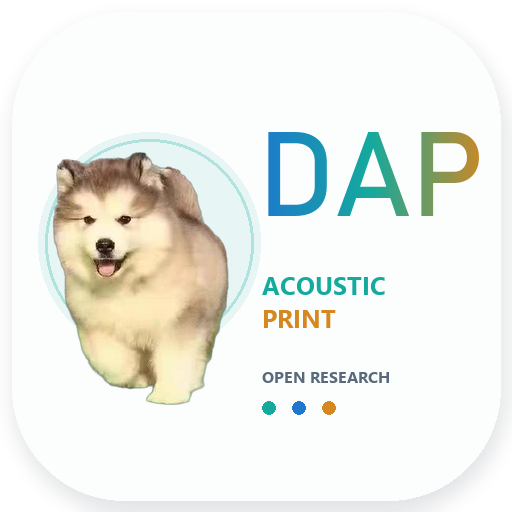
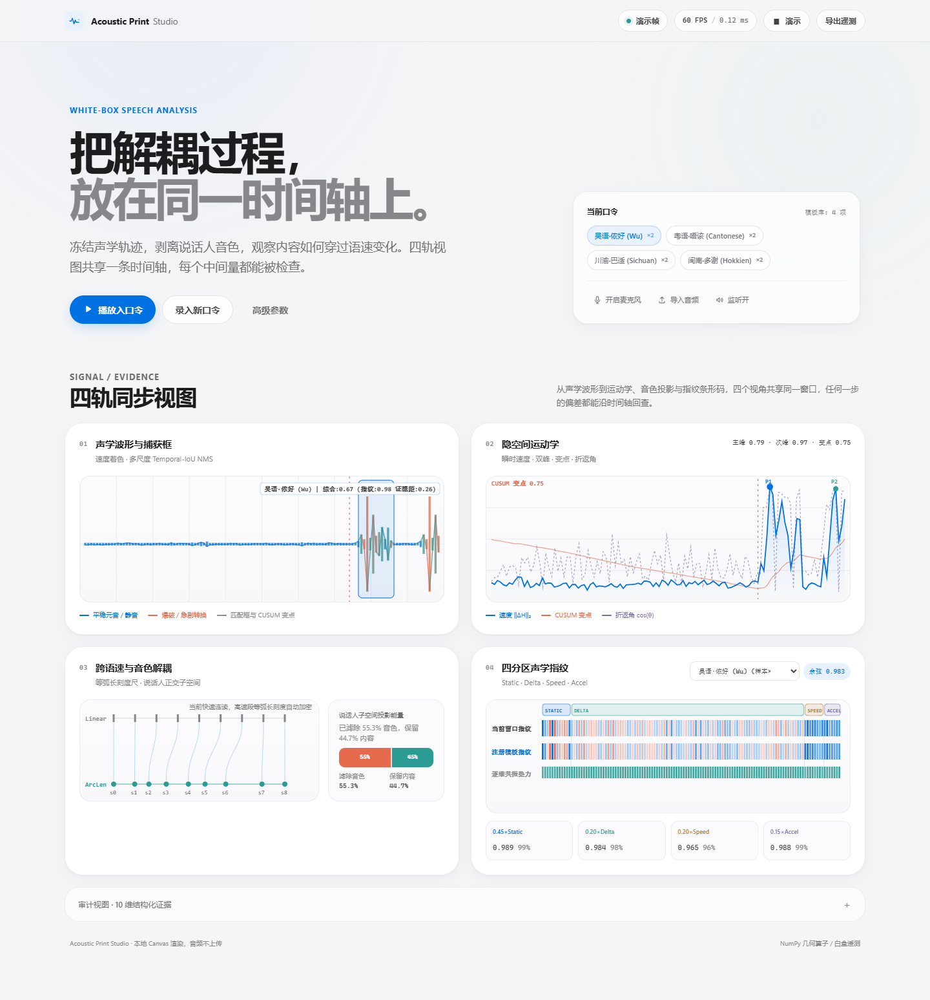
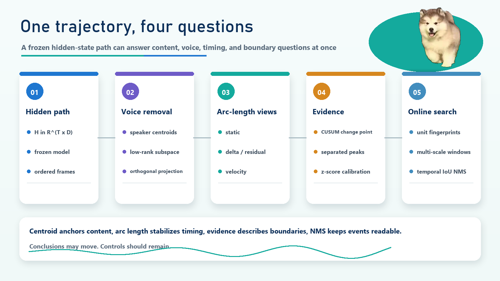

<p align="center">
  <a href="https://github.com/leeoisaboy/disentangle-acoustic-print">
    
  </a>
</p>

<p align="center">
  <a href="README.md"></a>
  <a href="https://leeoisaboy.github.io/disentangle-acoustic-print/"></a>
  
  
  
</p>

<h1 align="center">Disentangle-Acoustic-Print</h1>

<p align="center"><strong>Turn a frozen speech trajectory into interpretable temporal views, with every operator shown live.</strong></p>



## The Running Interface

<p align="center">
  <a href="https://leeoisaboy.github.io/disentangle-acoustic-print/">
    
  </a>
</p>

<p align="center"><strong><a href="https://leeoisaboy.github.io/disentangle-acoustic-print/">Open Acoustic Print Studio</a></strong></p>

The animation is captured from the working page. The default view keeps one primary action, the current phrase, and the four tracks. Tempo, timber, threshold, and enrollment controls unfold on demand. The online Studio runs in the browser and supports microphone streaming, WAV drag-and-drop, a frame-shuffle control, dual-tempo enrollment, and telemetry export. The static page needs no backend and processes audio locally.

All four tracks read the same telemetry packet.

| Track | What appears on screen | Implementation |
| --- | --- | --- |
| Track 01 | Speed-colored waveform, multi-scale capture boxes, temporal IoU suppression | `OnlineMatcher`, `decompose().speed` |
| Track 02 | Instantaneous speed, two peaks, zero-mean CUSUM change point, turning angle | `extract_evidence`, `compute_cusum_curve` |
| Track 03 | Linear and equal-arc-length rulers, speaker-subspace stripping energy | `arc_length_resample`, `SpeakerSubspaceProjector` |
| Track 04 | Four-part Static, Delta, Speed, and Accel fingerprint barcode | `fingerprint`, `decompose_fingerprint_barcode` |

<details>
<summary>Open the full four-track screenshot</summary>
<p align="center">
  
</p>
</details>

## Why This Project

Smart-home and assisted-living devices keep meeting new dialect commands. When another speaker says the same phrase, timbre and speaking rate change with the voice. A single averaged vector can absorb the speaker into the lexical representation. A pure frame-difference descriptor can move in the opposite direction because every voice has a different rhythm.

This project studies how content and voice mix along the time axis of a frozen speech representation. The library splits a hidden-state trajectory into static, delta, residual, and velocity views, adds structured boundary and timing evidence, and locates events with multi-scale online matching. The core retrieval and geometry operators use NumPy and train no additional matcher.

Studio renders those intermediate quantities. The waveform, change point, peaks, resampling ruler, speaker-stripping energy, and four-part fingerprint share one time axis, so an algorithm failure remains visible at the operator that produced it.

## Questions

1. Which view preserves content across speakers, the static centroid or the first-order motion?
2. Can arc-length parameterization remove smooth speaking-rate changes from a temporal descriptor?
3. Can a low-rank orthogonal projection reduce timbre leakage when speaker variation is a rotation?
4. When does structured evidence improve acoustic retrieval, and when does it add noise?
5. How can an online scan return separate events instead of adjacent copies of one peak?
6. Can one telemetry packet expose all of these decisions frame by frame in a browser?

## What The Evidence Says

The deterministic fixtures test numerical behavior and API contracts. They do not stand in for real dialect speech. The following values come from earlier local exploration logs.

| Probe | Result | Reading |
| --- | ---: | --- |
| Real temporal-shape Top-1 | 21.32% | Local motion carries phrase information |
| Frame-shuffle control | 14.60% | Breaking order costs 6.72 points |
| Single-vector retrieval bound | 58.05% | Static and velocity reference point |
| Structured-evidence oracle bound | 70.43% to 71.76% | Evidence summaries leave visible headroom |

The shuffle control shows that order matters. The oracle gap shows that structured evidence is worth studying, while an oracle number is not an online gain.

This release makes the following engineering claims directly testable.

- Temporal views can use equal-arc-length resampling by default.
- Zero-mean CUSUM and separated local peaks replace degenerate summary statistics.
- Query and template fingerprints share the same L2-normalized geometry.
- Incremental enrollment uses count-weighted means and invalidates cached evidence calibration.
- Multi-scale scans pass through temporal IoU NMS before returning top-k events.
- The audio bridge, rolling stream buffer, and four-track telemetry have end-to-end tests.

## Method

<p align="center">
  
</p>

For a trajectory $H \in \mathbb{R}^{T \times D}$, the library exposes four views.

| View | Construction | Purpose |
| --- | --- | --- |
| Static centroid | $\mu_H = T^{-1}\sum_t H_t$ | Cross-voice lexical anchor |
| Delta shape | $\Delta H_t = H_{t+1}-H_t$ after optional arc-length resampling | Articulatory transition direction |
| Residual path | $H_t-\mu_H$ | Motion relative to the phrase center |
| Velocity profile | $\lVert \Delta H_t \rVert_2$ | Local energy, duration, and tempo evidence |

`StructuredEvidence` stores response, a CUSUM change point, two separated peaks, speed statistics, turning statistics, and a normalized boundary contour. Evidence vectors can be z-scored against enrollment samples and fused with fingerprint cosine scores.

Five engineering choices carry the implementation.

- `arc_length_resample()` samples by cumulative chord length, which reduces the effect of smooth speaking-rate changes.
- `SpeakerSubspaceProjector` estimates a low-rank speaker subspace from speaker centroids and projects it out of a trajectory.
- `EnrollmentBank` stores unit fingerprints, running means, and evidence samples. Calibration is cached until the bank changes.
- `OnlineMatcher` scans several window scales and applies temporal IoU NMS to overlapping results.
- `RollingAcousticStream` joins 16 kHz audio, a rolling ring buffer, live enrollment, and four-track telemetry into one data path.

## Using Studio

The online page opens in a browser. It starts a multi-scale capture demo, and the controls can trigger dialect phrases, change tempo and speaker nuisance, or open a microphone stream.

The static page needs no backend dependency.

```bash
python -m http.server 8765 --directory studio
```

Open `http://127.0.0.1:8765`.

For the WebSocket backend, launch the FastAPI entry point.

```bash
python -m pip install -e ".[studio]"
python -m studio.app --mode fastapi --port 8000
```

For Hugging Face Spaces or a Gradio streaming page, use the second entry point.

```bash
python -m pip install -e ".[spaces]"
python -m studio.app --mode gradio --port 7860
```

## Quickstart

```bash
python -m venv .venv
python -m pip install -e .
```

```python
from disentangle_acoustic_print import (
    EnrollmentBank,
    OnlineMatcher,
    SpeakerSubspaceProjector,
    make_cross_voice_dataset,
    make_stream,
)

dataset = make_cross_voice_dataset(dimensions=16)
projector = SpeakerSubspaceProjector.fit(
    dataset["sequences"],
    dataset["speaker_ids"],
    rank=2,
)

frames = dataset["sequences"][0]
bank = EnrollmentBank(projector=projector, evidence_weight=0.2)
bank.enroll("phrase-a", [frames])
print(bank.search(frames)[0])

stream = make_stream(
    dimensions=16,
    target=frames.mean(axis=0),
    insert_start=10,
    target_length=len(frames),
)
locator = OnlineMatcher(
    bank,
    window_length=len(frames),
    scales=(0.75, 1.0, 1.25),
    hop=2,
    iou_threshold=0.4,
)
print(locator.match(stream)[0])
```

```bash
disentangle-acoustic-print demo
disentangle-acoustic-print evidence
disentangle-acoustic-print fingerprint
disentangle-acoustic-print online
disentangle-acoustic-print telemetry
```

## Why It Matters

The package is a diagnostic harness for speech representations. Swap a layer, a model, or a pooling rule, then inspect content stability, speaker leakage, and temporal robustness separately. `layerwise_probe` reports those components per feature column.

It is also a low-resource retrieval baseline. A new word needs a small enrollment set. Acoustic localization proposes candidates, structured evidence adds boundary and timing cues, and the online matcher finds events in a continuous stream. Studio turns the baseline into an operating surface where tempo, speaker nuisance, and fusion weight produce immediate four-track responses.

The project keeps its failure cases visible. Deterministic fixtures, numerical contracts, and negative results are part of the deliverable. A retrieval baseline that explains failure is more useful than a demo that succeeds once.

## Scope

- The public API accepts `[time, dimension]` hidden-state trajectories.
- The repository ships no model weights, private manifests, or remote service credentials.
- Synthetic fixtures and Studio presets test interfaces and interaction, not real Wu or Mandarin recognition accuracy.
- Fit `SpeakerSubspaceProjector` only on speakers allowed into enrollment or development analysis.
- Tune window scales and temporal IoU for the target frame rate, word length, and event density.
- Oracle bounds from historical logs are not online Top-1 results.
- Browser microphone access needs a secure context or localhost permission and the browser consent prompt.

## Repository Layout

```text
disentangle_acoustic_print/
  geometry.py       temporal decomposition, arc-length resampling, speaker projection
  probing.py        layer probes, ranking metrics, grouped calibration
  evidence.py       CUSUM change point, peaks, structured evidence calibration
  fingerprint.py    unit fingerprints, hybrid bank, multi-scale online locator
  synthetic.py      deterministic fixtures with tempo warp and orthogonal rotation
  audio_bridge.py   16 kHz WAV codec, Mel trajectory extractor, optional model bridge
  telemetry.py      four-track white-box telemetry serializer
  stream_engine.py  ring buffer, dual-tempo enrollment, live matching
  cli.py            JSON demos and command-line entry points
studio/
  index.html        backend-free four-track Canvas oscilloscope
  static/           light interface styles and deterministic Canvas renderer
  app.py            FastAPI WebSocket and unified launcher
  gradio_app.py     Hugging Face Spaces streaming dashboard
docs/
  DATA_CONTRACT.md
  MODULE_MAP.md
  assets/           banners, logo, pipeline art, screenshot, animated preview
scripts/
  make_assets.py    render README assets
tests/
  23 numerical, audio, telemetry, and API regression tests
```

## Development

```bash
python -m compileall -q .
python -m pytest -q
```

The current suite reports `23 passed`. See [docs/DATA_CONTRACT.md](docs/DATA_CONTRACT.md) for input requirements and [docs/MODULE_MAP.md](docs/MODULE_MAP.md) for module ownership.

## License

MIT. Audio, model weights, and derived features retain their original licenses.

**A useful acoustic retrieval baseline should explain both its hits and its failures.**
