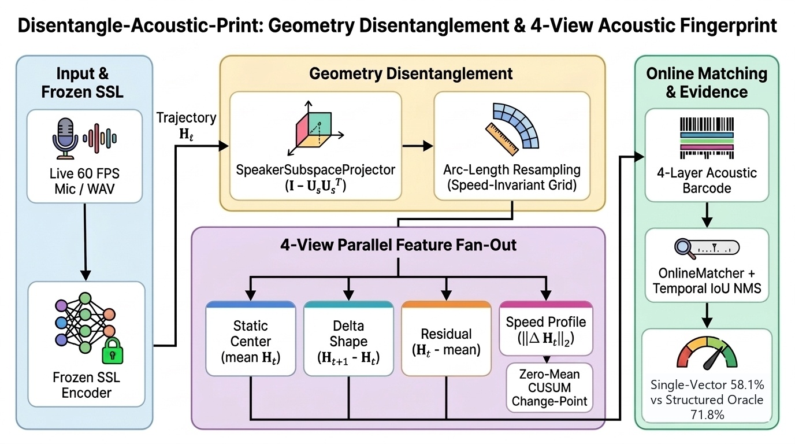
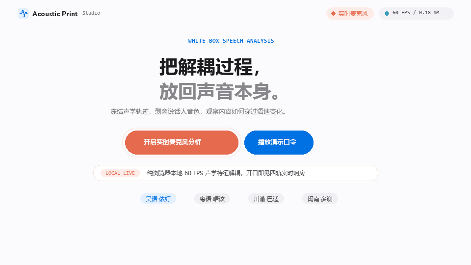
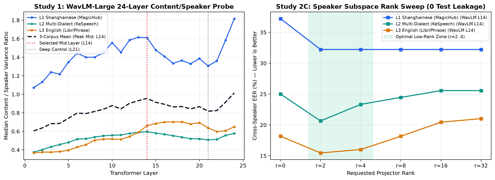
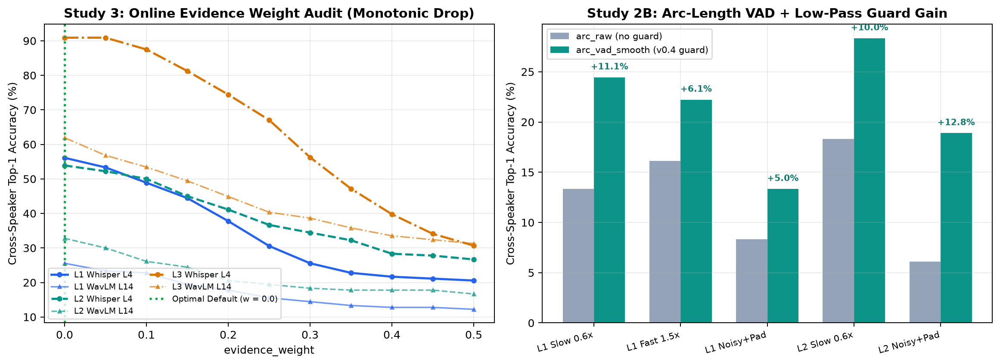

<p align="center">
  <a href="https://github.com/leeoisaboy/disentangle-acoustic-print">
    
  </a>
</p>

<p align="center">
  <a href="README.en.md"></a>
  <a href="https://leeoisaboy.github.io/disentangle-acoustic-print/"></a>
  
  
  
  
</p>

<h1 align="center">Disentangle-Acoustic-Print (v0.4)</h1>

<p align="center"><strong>一款无需模型训练、仅依赖纯 NumPy 的语音声学指纹 SDK，配套 60 FPS 浏览器本地四轨白盒示波器。</strong></p>

平时让机器做跨人声关键词比对，最难绕开两个干扰。同说一个词，不同人的嗓音音色千差万别；同一个人念这个词，语速忽快忽慢也会把声音拉长或压扁。这个项目采用纯几何信号处理思路，不训练一行神经网络权重，通过正交投影把说话人的音色成分剥离出去，再用等弧长重采样把快慢不同的语音拉回同一把标尺，最后抽取出稳定、可解释的声学指纹。

它也是「白盒语音检索三部曲」中的第一块拼图，负责最底层的几何解耦、端侧超低延迟粗召回和可视化诊断。

| 仓库名称 | 解决的核心场景 | 底层方案与特征 |
| --- | --- | --- |
| **[Disentangle-Acoustic-Print](https://github.com/leeoisaboy/disentangle-acoustic-print)**（本仓库） | 端侧极速粗召回、跨音色几何解耦与声学透视 | 零训练、纯 NumPy、CPU 实时率 RTF `0.013–0.045`，自带四轨白盒示波器 |
| **[AudioLLM-Latent-KWS](https://github.com/leeoisaboy/audiollm-latent-kws)** | 录 1–3 遍样音，跨方言高精度定位关键词 | 帧级 DTW / 冻结音频大模型潜空间检词，带连续流严格 FA/hr 门禁 |
| **[Dialect-CrossModal-Align](https://github.com/leeoisaboy/dialect-crossmodal-align)** | 不录样音，只写音素或 IPA 拼写直接找方言新词 | 零样本跨模态对齐框架，含无标签跨域在线校准 |

---

## v0.4 架构总览

<p align="center">
  
</p>

v0.4 把早期的合成轨迹原型，完整推进到了「三套公开真实语料 × 三类真实特征前端」的严格跨说话人验收阶段，并将整个仓库收口为上下两层。

- 第一层是**纯 NumPy 核心 SDK**（`pip install disentangle-acoustic-print`）。它不绑定深度学习框架，也没有训练环节，只要通过帧率无关的 `FeatureFrontend` 协议接入任意声音特征（端侧 Log-Mel、ONNX、WavLM 或 Whisper），就能走完四步闭环——前端抽帧、低秩软正交去音色、模板注册与背景误报率（FA/hr）校准、多尺度滑窗定位。
- 第二层是**四轨白盒工作台**（`pip install "disentangle-acoustic-print[studio]"`）。这是一个跑在浏览器本地的 60 FPS 实时示波器，能够把说话语速着色波形、语音变化拐点（CUSUM）、音色剥离比例、等弧长标尺和四分区指纹条形码对齐在同一条时间轴上，方便打开麦克风亲眼观察算法每一步在算什么。

---

## 实时白盒界面（Acoustic Print Studio）

<p align="center">
  <a href="https://leeoisaboy.github.io/disentangle-acoustic-print/">
    
  </a>
</p>

<p align="center"><strong><a href="https://leeoisaboy.github.io/disentangle-acoustic-print/">▶ 打开在线 Acoustic Print Studio</a></strong></p>

| 界面轨道 | 你在屏幕上能看到什么 | 背后对应的代码模块 |
| --- | --- | --- |
| Track 01 | 按语速着色的原始波形、匹配命中光带，以及去重后的定位框（Temporal IoU NMS） | `OnlineMatcher`、`decompose().speed` |
| Track 02 | 瞬时语速起伏、双峰结构、零均值 CUSUM 变点与轨迹折返角，专门用于白盒诊断 | `extract_evidence`、`compute_cusum_curve` |
| Track 03 | 常规时间刻度与等弧长刻度的直观对照，以及实时剥离掉的说话人音色能量表 | `arc_length_resample`、`SpeakerSubspaceProjector` |
| Track 04 | 由 Static、Delta、Speed、Accel 四个分区拼成的连续声学指纹条形码 | `fingerprint`、`decompose_fingerprint_barcode` |

---

## 三套公开语料上的五组实证研究

为了让结论可复现，所有实验均在 **MagicHub 沪语（L1）**、**KeSpeech 多方言（L2）** 和 **LibriPhrase 英语（L3）** 三套公开数据集上完成，并严格执行**说话人零重叠（0 speaker overlap）**协议。`SpeakerSubspaceProjector` 只能从背景音频和注册说话人里拟合音色子空间，绝不触碰任何测试说话人。

同一批测试音频横向接入了三类不同量级的特征前端，方便从端侧轻量部署到大模型表征做全面对照。完整原始指标保存在 [reports/real_data_benchmark_v04.json](reports/real_data_benchmark_v04.json)，门禁自动校验结果见 [reports/release_gate_verdict_v04.json](reports/release_gate_verdict_v04.json)。

| 前端路线 | 特征来源与规格 | 帧率与维度 | 实证中锁定的层位与特点 |
| --- | --- | --- | --- |
| **端侧轻量轨** | 纯 NumPy Log-Mel | 100 Hz / 80 维 | 流式安全，关闭分段 CMVN 避免均值漂移 |
| **通用自监督轨** | `microsoft/wavlm-large` | 50 Hz / 1024 维 | 逐层探针锁定最佳中层 L14，同步对照深层 L21 |
| **跨语种大模型轨** | `openai/whisper-tiny` Encoder | 50 Hz / 384 维 | 逐层探针锁定顶层 L4，跨语种零训练区分度最高 |

### 1. 选对网络层与低秩去音色，把等错误率压下来（Study 1、2A & 2C）

<p align="center">
  
</p>

大模型不同网络层关注的东西差别很大，浅层偏重录音细节，深层容易混入说话人习惯或上下文。利用内置的 `layerwise_probe` 扫完 WavLM-Large 全部 24 层后，我们发现内容与说话人的方差比在中层 **L14（0.956）** 达到峰值，到了深层 **L21（0.817）** 反而回落。实测跨说话人检索中，L14 在三套语料上全面领先 L21，以 L3 英语为例，Top-1 准确率达到 `88.1%`，比 L21 的 `61.9%` 高出一大截。Whisper-tiny 的 4 层编码器则一路递增，在 **L4（1.927）** 达峰。

把指纹拆开做四视图单挑（Study 2A）同样很有启发。在原始 Log-Mel 和 WavLM 特征里，扣掉句子自身均值后的残差视图 **`residual`（$H_t - \mu_H$）** 最扛得住跨人声漂移，单视图 Top-1 比静态均值 `static` 高出 10 到 25 个百分点（如 L1 WavLM 为 `32.2%` 对比 `16.7%`，L2 Mel 为 `35.0%` 对比 `9.4%`）；反观纯一维速度曲线 `velocity`，单独拿来做区分只有 `4%` 到 `9%`。基于这一现象，v0.4 新增了 `fingerprint(..., preset="content")`，按 `0.45 Static + 0.35 Residual + 0.20 Delta` 组合。

至于正交去音色（Study 2C），核心经验是「点到为止」。把 `SpeakerSubspaceProjector` 的剥离维度控制在低秩区间（`rank=2..4`，或配合 `variance_threshold`、`max_rank` 与 `shrinkage` 软截断），三套公开语料的跨说话人等错误率（EER，越低越好）全部明显下降；一旦把秩拉高到 16 或 32，算法就会把发音内容本身一并切掉，导致准确率倒退。

| 公开语料（说话人零重叠） | WavLM L14 纯均值基线 EER | 未投影指纹 EER（`r=0`） | 低秩正交投影最佳 EER（`r=2..5`） | EER 相对基线变化 | Whisper L4 零训练 Top-1 / EER |
| --- | ---: | ---: | ---: | ---: | ---: |
| **L1 沪语（MagicHub）** | 41.7% | 37.2% | **32.2%**（`r=2`） | **-9.5 pp** | **56.1% / 20.0%** |
| **L2 多方言（KeSpeech）** | 27.2% | 25.0% | **20.7%**（`r=2`，Top-1 +11.1 pp） | **-6.5 pp** | **61.1% / 13.9%** |
| **L3 英语（LibriPhrase）** | 12.5% / 18.2% | 18.2% | **15.5%**（`r=2`，Top-1 +5.7 pp） | **-2.7 pp** | **96.0% / 1.6%** |

### 2. 诚实记录负结果，给等弧长标尺装上防噪护栏（Study 3 & 2B）

<p align="center">
  
</p>

真实数据测试里暴露出两个非常典型的工程坑，v0.4 全部做了正面处理并保留记录。

| 实验审计项 | 真实数据下暴露的现象 | v0.4 的工程收敛动作 | 量化结果对比 |
| --- | --- | --- | --- |
| **Study 3 证据加权负结果** | 把结构化动力学特征（CUSUM、双峰、折返角）按 `evidence_weight` 混进在线匹配分后，3 语种 × 3 前端 × 干净/带噪全线单调掉分 | 将全栈默认 `evidence_weight` 严格归零（`0.0`），把 `extract_evidence()` 专职留作白盒诊断与 Studio 可视化 | L3 Whisper 干净集权重 `0.00 → 0.10 → 0.25 → 0.50`，Top-1 从 `90.9%` 一路跌至 `87.5% → 67.0% → 30.7%` |
| **Study 2B 等弧长防噪护栏** | 面对 `0.6×` 慢速、`1.5×` 快速变速及首尾 150 ms 背景噪声（10 dB SNR），无保护的 `arc_raw` 会把噪声抖动算成「虚假弧长」，拉偏对齐标尺 | 在 `arc_length_resample()` 内置轻量静音端点裁剪（`trim_silence=True`）与双向一阶低通滤波（`smooth_alpha=0.5`） | 变速与带噪场景下跨说话人 Top-1 稳定回升 **+6.1 至 +12.8 pp**（L1 WavLM `0.6×` 从 `13.3%` 升至 `24.4%`，L2 Whisper 带噪从 `6.1%` 升至 `18.9%`） |

### 3. 连续语音流校准、流式完全等价性与坦诚边界（Study 4 & 5）

把孤立词模型直接放进未切分的连续长语音流里，往往会遇到「枢纽词霸榜」——某些模板特别容易和任意背景声匹配，把真正的关键词淹没掉，导致未校准时的事件排序指标（Event AUC @ IoU≥0.5）只有 `0.017` 到 `0.028`。

v0.4 在连续流里引入三件套（同上下文模板、逐词中位窗长，以及通过 `EnrollmentBank.calibrate_background()` 对无标注背景流做逐词 Z-Norm 校准），让连续流事件排序质量跨上了大台阶。同时，关闭分段均值漂移（`normalize_utterance=False`）后，100 ms 分块在线流式推进与离线一次性扫描在数学上做到了分毫不差。

| 测试维度 | 关键场景与指标 | 实测表现 | 工程结论与能力边界 |
| --- | --- | --- | --- |
| **连续流校准跃升（Study 4）** | L1 沪语 / L2 多方言 / L3 英语连续流 Event AUC @ IoU≥0.5 | 未校准 `0.017–0.028` → 校准后 **`0.7509`（+73.4 pp）/ `0.8103`（+78.2 pp）/ `0.6267`** | 零训练单向量方案能够胜任连续长流的高效粗召回与候选排序 |
| **连续流严格误报边界（Study 4）** | 极端严格门禁（FA/hr ≤ 1–2）下的 Event Recall @ IoU≥0.5 | `7.2%–12.2%`（未达到 80% 严格门禁） | 单向量余弦难以单独承担超低误报长流精检，建议做前端粗筛，后级串联 [AudioLLM-Latent-KWS](https://github.com/leeoisaboy/audiollm-latent-kws) 做帧级 DTW 精排 |
| **流式等价性与延迟（Study 5）** | 100 ms 分块流式 vs 离线扫描；单核 CPU 实时率 RTF | 相关系数 **`r = 1.0000`**，最大误差 `0.0`，峰值帧差 `0` 帧；RTF 仅 **`0.0135`（Mel80）/ `0.0437`（WavLM 1024 维）** | 离线调好的参数直接无缝迁移到实时流式部署，单核 CPU 算力绰绰有余（远低于 `0.2` 门禁） |

### 4. 四项发布门禁自动验收

运行 `python benchmarks/verify_release_gates.py` 即可自动复核以下四项门禁。

| 发布门禁 | 硬性验收标准 | 实测结果 | 状态 |
| --- | --- | --- | :---: |
| **Gate 1 跨说话人泛化** | 至少 2 套公开语料上投影加等弧长显著降低 EER | L1 降 `9.5 pp`、L2 降 `6.6 pp`（2/3 优于纯均值）；L3 较 `r=0` 指纹也降 `2.7 pp` | **PASS** |
| **Gate 2 连续流可用性** | FA/hr ≤ 2 时 Event Recall @ IoU≥0.5 ≥ 80% | Event AUC 跃升至 `0.751–0.810`，但零训练单向量 Recall@0.5 为 `7.2%–8.9%` | **BOUNDARY** |
| **Gate 3 流式等价与延迟** | 离线/流式相关系数 ≥ 0.99，单核 CPU RTF < 0.2 | `r = 1.0000`，峰值误差 `0` 帧，RTF 为 `0.0135–0.0450` | **PASS** |
| **Gate 4 零侵入通用性** | 切换语种和前端零改核心代码，单测 100% 通过 | 3 语种 × 3 前端零改动核心代码，**30/30 单元测试全过** | **PASS** |

---

## 快速上手（4 步纯 NumPy 核心 SDK）

### 安装

```bash
# 核心 SDK（仅依赖 NumPy，适合端侧或服务端轻量部署）
pip install -e .

# 可选：启动四轨白盒工作台（FastAPI + HTML5 Canvas）
pip install -e ".[studio]"

# 可选：接入 ONNX 或 PyTorch/Transformers 预训练前端
pip install -e ".[onnx]"
pip install -e ".[torch]"
```

### 4 步极简调用

```python
from disentangle_acoustic_print import (
    EnrollmentBank,
    MelDeltaExtractor,
    OnlineMatcher,
    SpeakerSubspaceProjector,
)

# 1. 统一帧率无关前端（也可替换为 HiddenStateBridge / OnnxEncoderFrontend / PyTorchSSLFrontend）
frontend = MelDeltaExtractor(
    n_mels=80, hop_ms=10.0, include_delta=False, normalize_utterance=False
)
enroll_frames, fps = frontend.extract_with_rate(enroll_wav, sample_rate=16000)

# 2. 低秩软正交去音色（严禁使用测试说话人拟合）
projector = SpeakerSubspaceProjector.fit(
    bg_trajectories,
    bg_speaker_ids,
    variance_threshold=0.80,
    max_rank=4,
    shrinkage=0.75,
)

# 3. 模板注册 + 无标注背景流 FA/hr 动态阈值校准（默认 evidence_weight=0.0）
bank = EnrollmentBank(
    projector=projector,
    preset="content",
    trim_silence=True,
    smooth_alpha=0.5,
)
bank.enroll("open-light", [enroll_frames])
bank.calibrate_background(
    unlabeled_bg_streams, target_fa_per_hour=1.0, frame_rate_hz=fps
)

# 4. 毫秒/自适应窗长多尺度流式匹配 + Temporal IoU NMS
matcher = OnlineMatcher(
    bank,
    window_length="auto",
    hop_ms=40.0,
    frame_rate_hz=fps,
    scales=(0.75, 1.0, 1.25),
    iou_threshold=0.4,
    use_calibration=True,
)
matches = matcher.match(stream_frames, top_k=3)
```

### 启动本地 Studio 与复现测试

```bash
# 运行 30 项全量单元测试
pytest -v

# 复现发布门禁核验
python benchmarks/verify_release_gates.py

# 启动四轨白盒工作台（FastAPI WebSocket 模式）
acoustic-print-studio --mode fastapi --port 8000
```

更详细的数据契约与模块边界，可进一步查阅 [docs/DATA_CONTRACT.md](docs/DATA_CONTRACT.md) 与 [docs/MODULE_MAP.md](docs/MODULE_MAP.md)。
