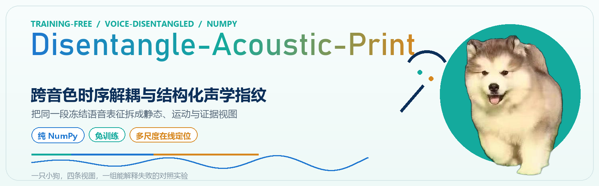
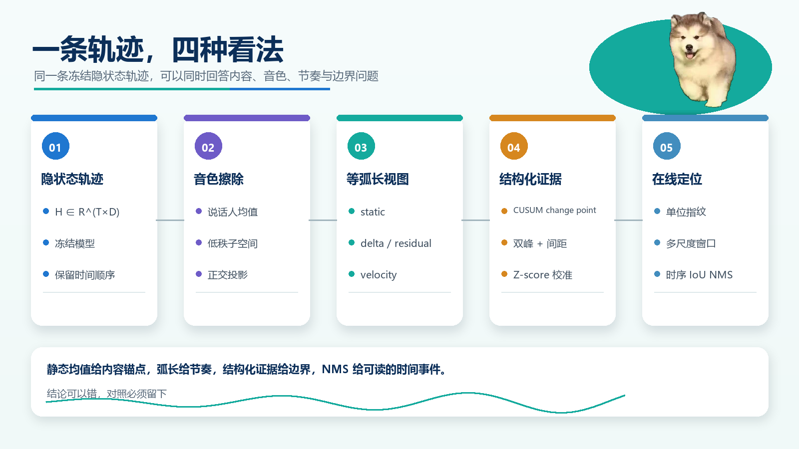

<p align="center">
  <a href="https://github.com/leeoisaboy/disentangle-acoustic-print">
    
  </a>
</p>

<p align="center">
  <a href="README.en.md"></a>
  
  
  
</p>

<h1 align="center">Disentangle-Acoustic-Print</h1>

<p align="center"><strong>把跨音色语音表征拆成可以解释的时序视图。</strong></p>


## 为什么做这个项目

智能家居和适老化设备会不断遇到新的方言指令。同一个词换一个人说，声纹变了，语速也变了。检索系统如果只看见一个平均向量，很容易把说话人的音色当成词的一部分。反过来，只保留帧间运动，发音人的节奏差异又会把同一句话推得很远。

这个项目研究一个更基础的问题。冻结的语音表征里，哪些信息能够跨音色保留，哪些信息一换人就失真。仓库把一段隐状态轨迹拆成静态、运动、残差、速度四类视图，再用结构化证据和多尺度在线匹配补齐边界与时序信息。整个流程只依赖 NumPy，不训练额外匹配器。

## 项目追问什么

1. 静态均值与一阶运动，哪一种视图更能跨说话人保留内容。
2. 同一个人改变语速后，怎样用弧长参数化把节奏从形状里拿走。
3. 音色差异表现为特征子空间旋转时，低秩正交投影能否降低泄漏。
4. 结构化证据与声学指纹怎样融合，什么时候有效，什么时候只增加噪声。
5. 在线扫描怎样避免同一个事件附近反复返回高度重叠的窗口。

## 先给结论

当前代码提供一套可复算的研究基线。确定性合成夹具负责验证接口、数值契约和失败模式，真实语音结论仍需要用户自己的音频与冻结特征。此前本地探索日志留下的证据如下。

| 探针 | 结果 | 说明 |
| --- | ---: | --- |
| 真实时序形状 Top-1 | 21.32% | 局部运动携带可用的词条信息 |
| 打乱帧序后的 Top-1 | 14.60% | 破坏顺序后下降 6.72 点 |
| 单向量检索上限 | 58.05% | 静态与速度视图的参考上限 |
| 结构化证据 oracle 上限 | 70.43% 至 71.76% | 证据摘要存在明显余量 |

这些数字来自原始本地探索日志。它们说明帧序确实包含信息，也说明结构化证据有潜力。oracle 上限不能直接当作在线增益，真实收益仍取决于校准、候选池和融合权重。

这一版没有把合成夹具分数写成真实语料结论。当前能够直接验证的是数值行为与工程契约。

- 四类时序视图都有独立实现，弧长重采样可以作为默认时序归一化。
- 零均值 CUSUM、局部峰筛选和最小间距抑制替代了退化的统计量。
- 指纹与模板统一 L2 归一化，增量注册按累计样本数更新。
- 证据校准只在注册数据变化时重算，在线混合检索直接复用缓存。
- 多尺度窗口经过 temporal IoU NMS，返回结果不会再被相邻窗口挤满。

## 方法

<p align="center">
  
</p>

给定轨迹 $H \in \mathbb{R}^{T \times D}$，仓库提供四种互补视图。

| 视图 | 构造 | 作用 |
| --- | --- | --- |
| 静态中心 | $\mu_H = T^{-1}\sum_t H_t$ | 跨音色的内容锚点 |
| 差分形状 | $\Delta H_t = H_{t+1}-H_t$，可先做等弧长重采样 | 发音过渡方向 |
| 残差轨迹 | $H_t-\mu_H$ | 相对词条中心的运动位置 |
| 速度剖面 | $\lVert \Delta H_t \rVert_2$ | 快慢、长短与局部能量证据 |

结构化证据包含响应强度、零均值 CUSUM 变点、两个分隔峰、速度统计、转角统计和归一化边界轮廓。证据向量按注册样本做 Z-score 校准，再与指纹余弦得分融合。

工程上有四个关键选择。

- `arc_length_resample()` 按累积弦长等距采样，降低说话速度变化对时序描述的影响。
- `SpeakerSubspaceProjector` 从说话人均值估计低秩音色子空间，再把该子空间从轨迹中投影掉。
- `EnrollmentBank` 保存单位指纹、累计均值和证据样本。校准器缓存在下一次注册前一直有效。
- `OnlineMatcher` 支持多个窗口长度，并用 temporal IoU NMS 抑制重叠结果。

## 快速开始

```bash
python -m venv .venv
python -m pip install -e .
```

Windows PowerShell 使用 `.venv\Scripts\Activate.ps1`。

```python
from disentangle_acoustic_print import (
    EnrollmentBank,
    OnlineMatcher,
    SpeakerSubspaceProjector,
    make_cross_voice_dataset,
    make_stream,
)

dataset = make_cross_voice_dataset(dimensions=16)
projector = SpeakerSubspaceProjector.fit(
    dataset["sequences"],
    dataset["speaker_ids"],
    rank=2,
)

frames = dataset["sequences"][0]
bank = EnrollmentBank(projector=projector, evidence_weight=0.2)
bank.enroll("phrase-a", [frames])
print(bank.search(frames)[0])

stream = make_stream(
    dimensions=16,
    target=frames.mean(axis=0),
    insert_start=10,
    target_length=len(frames),
)
locator = OnlineMatcher(
    bank,
    window_length=len(frames),
    scales=(0.75, 1.0, 1.25),
    hop=2,
    iou_threshold=0.4,
)
print(locator.match(stream)[0])
```

命令行提供四个确定性演示。

```bash
disentangle-acoustic-print demo
disentangle-acoustic-print evidence
disentangle-acoustic-print fingerprint
disentangle-acoustic-print online
```

## 这个原型有什么意义

它可以作为自监督语音表征的诊断工具。换层、换模型或换池化方式时，四类视图能把内容保持、音色泄漏和时序稳定性拆开报告。`layerwise_probe` 还能直接比较不同特征层的内容方差与说话人方差。

它也可以作为低资源词条检索的基线。新词只需要少量注册轨迹。声学定位给出候选，结构化证据负责补充边界与节奏线索，在线匹配器负责在连续流里找事件。

它最有价值的地方在于保留失败。合成数据可以复现，数值契约可以测试，阴性结果可以复核。一个能解释失败的声音检索基线，比一个只在演示里正确的结果更接近可用的研究工具。

## 实验边界

- 仓库只接收 `[time, dimension]` 隐状态轨迹，不包含音频解码、模型权重或私有清单。
- 合成夹具用于接口检查，不代表真实吴语或普通话语料上的效果。
- `SpeakerSubspaceProjector` 只能使用允许参与建模的注册说话人拟合，查询说话人不应进入估计。
- temporal IoU 阈值与窗口尺度仍需要按实际帧率、词长和事件密度调整。
- 历史日志中的 oracle 上限不是线上 Top-1，不能直接用于产品承诺。

## 仓库结构

```text
disentangle_acoustic_print/
  geometry.py    时序分解、弧长重采样、音色子空间投影
  probing.py     层探针、排序指标与分组校准
  evidence.py    CUSUM 变点、峰提取、结构化证据校准
  fingerprint.py 单位指纹、混合检索、多尺度在线定位
  synthetic.py   带语速形变与正交旋转的确定性夹具
  cli.py         JSON 演示与命令行入口
docs/
  DATA_CONTRACT.md
  MODULE_MAP.md
  assets/        横幅、LOGO、流程插图与小狗形象
scripts/
  make_assets.py 生成 README 视觉资产
tests/
  20 个数值与接口回归测试
```

## 复现与测试

```bash
python -m compileall -q .
python -m pytest -q
```

当前测试结果见仓库徽章。输入契约见 [docs/DATA_CONTRACT.md](docs/DATA_CONTRACT.md)，模块职责见 [docs/MODULE_MAP.md](docs/MODULE_MAP.md)。

## 许可

代码使用 MIT License。音频、模型权重和派生特征保留各自原始许可。

**一个值得留下的声音检索基线，应当同时解释它为什么命中，以及它为什么失败。**
